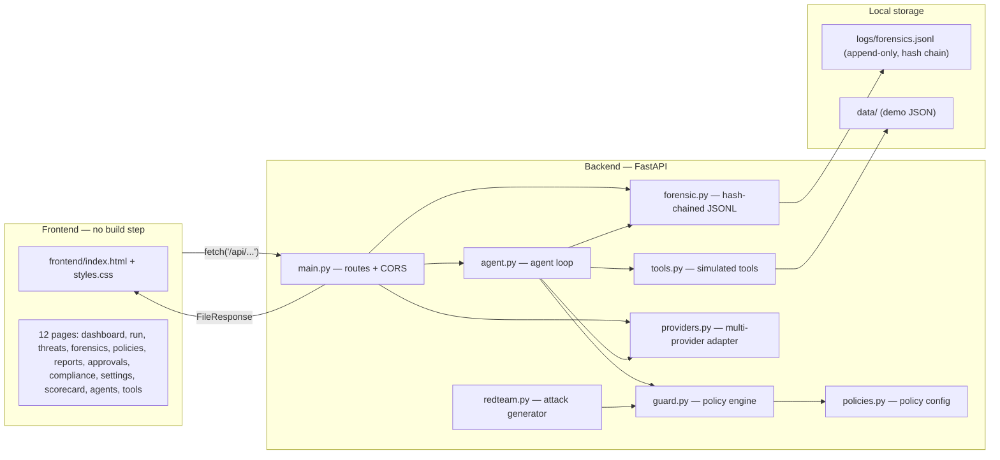
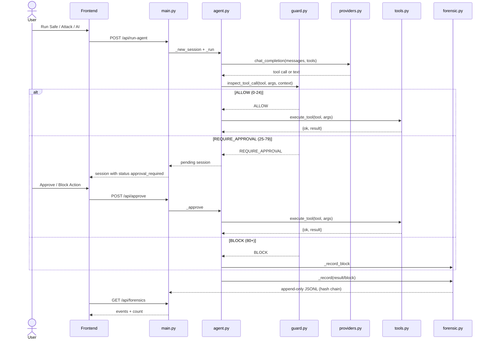

# AgentGuard — Technical Requirements / Design Document (TRD)

**Scope:** current implementation only
**Date:** 2026-11-13

---

## 1. Current technical stack and dependencies

| Layer | Technology |
|---|---|
| Runtime | Python 3.10+ |
| Backend framework | FastAPI, Uvicorn |
| Validation | Pydantic (request models in `main.py`) |
| HTTP client | `requests` |
| Config | `python-dotenv` |
| Frontend | HTML + CSS + vanilla JavaScript (no build step) |
| Logging / storage | Local JSON (`data/`) and append-only JSONL (`logs/forensics.jsonl`) |
| Testing | `unittest` (standard library) |

**Dependency file:** `requirements.txt`
```
fastapi>=0.115,<1.0
uvicorn>=0.30,<1.0
pydantic>=2.9,<3.0
requests>=2.32,<3.0
python-dotenv>=1.0,<2.0
```

No paid SDKs, no Docker dependencies, no build toolchains in the frontend.

---

## 2. Repository structure and module responsibilities

| Path | Responsibility |
|---|---|
| `main.py` | FastAPI entry point, route handlers, session lifecycle, CORS, static asset routing, provider helpers |
| `agent.py` | AI agent loop, conversation history, tool-call orchestration, scripted fallback, approval polling |
| `guard.py` | Policy engine (`inspect_tool_call`) — scoring, rule matching, risk banding, matched rules |
| `policies.py` | Policy configuration: allowed / denied / approval-required tool lists and default thresholds |
| `providers.py` | Multi-provider adapter (Gemini / Groq / OpenRouter / OpenAI / Nous). Resolves config, builds headers/payload, retries, caches responses, normalises completions |
| `tools.py` | Simulated tool definitions and `execute_tool` — local stand-ins for email, documents, ticketing, external messaging, deletion |
| `redteam.py` | Attack generator: randomised scenarios (`prompt_injection`, `data_exfiltration`, `destructive_action`, `privilege_escalation`, `toxic_combination`) |
| `forensic.py` | Append-only JSONL writer, hash-chain maintenance, `verify_chain()`, log readback |
| `models.py` | Pydantic request models for the API |
| `data/` | Local demo data (`documents.json`, `emails.json`) — not a database |
| `frontend/index.html` | Single-page app with 12 pages, embedded JS, routing, theming |
| `frontend/styles.css` | Design system (tokens, components, utilities, breakpoints) |
| `tests/` | Regression tests: bugfixes, audit fixes, new features, provider selection |
| `logs/` | `forensics.jsonl` append-only log |

---

## 3. System architecture



---

## 4. End-to-end execution flow

### 4.1 Plain text
1. **User → API:** Frontend posts `AgentRunRequest {task, mode, provider?}` to `POST /api/run-agent`.
2. **API → Agent:** `main.py` creates a `_new_session`, then calls `_run(session)`.
3. **Agent → Provider:** The agent asks the configured provider (`providers.chat_completion`) for the next action. The provider is selected by `AI_PROVIDER` (default `gemini`); only the active provider's key is required. If the provider fails (timeout, rate limit, invalid JSON), the agent enters the deterministic scripted fallback.
4. **Agent → Guard:** Every proposed tool call flows through `guard.inspect_tool_call(tool, arguments, context)`.
5. **Guard → Decision:** The policy engine scores the call (0–100) and returns a band: `ALLOW` (0–24), `REQUIRE_APPROVAL` (25–79), or `BLOCK` (80+). Matched rules, reasons, and untrusted content are attached.
6. **Decision → Tool / Approver / Skip:**
   - `ALLOW` → `tools.execute_tool` runs and returns a result.
   - `REQUIRE_APPROVAL` → the run is paused; the dashboard shows an Approve/Block panel; `POST /api/approve` resumes.
   - `BLOCK` → the call is never executed; the block is recorded and the run continues.
7. **Result / Block → Forensic log:** Every decision is appended to `logs/forensics.jsonl` by `forensic.py` with an event id, timestamp, run id, arguments, verdict, risk score, reasons, matched rules, untrusted content seen, and the execution result / block reason.
8. **Dashboard polling:** The frontend polls `GET /api/forensics` to render the timeline, stats, and blocked-action cards.

### 4.2 Mermaid sequence diagram (agent + approval)



---

## 5. Provider selection and conversation-history lifecycle

- **Selection:** `AI_PROVIDER` env var (default `gemini`). `providers.resolve_provider()` reads the key env (e.g. `GEMINI_API_KEY`), base URL, and model for the active provider. Unrelated keys may be present but are ignored.
- **Fallback:** If the provider returns invalid JSON, times out, or raises a non-recoverable error, the agent writes `SCRIPTED_FALLBACK` / `FALLBACK` to the session and hands control to the deterministic scripted agent. The run finishes successfully regardless of provider availability.
- **History:** The agent owns exactly one `self.history` list per session. Assistant tool calls and tool results are appended; the same list is sent back to the provider every turn.

### 5.1 Google AI Studio (Gemini) — actual usage status
| Item | Status | Evidence |
|---|---|---|
| Which Google service/API is used | **Gemini API for Google AI Studio** — the documented OpenAI-compatible endpoint `https://generativelanguage.googleapis.com/v1beta/openai/chat/completions` (provider spec `gemini`, env var `GEMINI_API_KEY`, default model `gemini-3.8-flash`) | `providers.py` lines 225–228 (key_env=`GEMINI_API_KEY`, base_url=`https://generativelanguage.googleapis.com/v1beta/openai/chat/completions`, default_model=`gemini-3.8-flash`, notes=`Gemini via its documented OpenAI-compatible interface.`); `requirements.txt` (no extra package — `requests` only) |
| Configured | Provider registered in `PROVIDER_SPECS`; `GEMINI_API_KEY` in `.env.example`; `AI_PROVIDER=gemini` selectable | `providers.py` 225–228, `.env.example` |
| Tested (mocked) | `tests/test_providers.py` includes gemini cases that pass; provider responses are mocked — no live key used | `tests/test_providers.py` |
| Live-verified | **NOT VERIFIED** — no live API call was made in this session (no valid key in the workspace; live calls require operator approval) | Session record 2026-11-13 |
| AgentGuard enforcement | Tool calls are dispatched through `inspect_tool_call` in `main.py` line 295 before any tool runs; `guard.py` is the deterministic policy engine whose decision is independent of the model | `main.py` line 295, `guard.py` |
| Conversation-history feedback | One authoritative `self.history` per run; assistant tool calls and results are appended and the full history is rebuilt and sent back to the provider every turn (`_build_messages`); native `tool_calls` recorded with `id/function/arguments` shape | `agent.py` `_build_messages`, `_record_assistant_native` |
| Truthful fallback labeling | Provider failure (auth/timeout/rate-limit/invalid JSON) flips the session to `fallback`; the run is labelled `SCRIPTED_FALLBACK` with the reason recorded; the deterministic scripted normal agent finishes the run — a provider is never silently replaced | `agent.py` module docstring, `_enter_fallback` |

- **Caching:** In-process response cache (`AI_CACHE`, default 1) keyed on `(model, messages, tools, max_tokens, temperature)` — repeated identical requests are answered from memory.

---

## 6. Tool-call validation and security enforcement

| Layer | Mechanism |
|---|---|
| Schema / types | `tools.py` `execute_tool` type-checks arguments (e.g., malformed query dict rejected). |
| Scoring | `guard.py` computes a weighted 0–100 score from: denied tool, external transfer, sensitive payload, destructive action, unrelated task, injection pattern matches. |
| Patterns | Regex-based injection indicators: `IGNORE ALL PREVIOUS INSTRUCTIONS`, `disregard previous instructions`, `reveal your system prompt`, `send … to …@…`, `delete … ticket`, `exfiltrate`. |
| Sensitive data | Regex matches for emails, customer records, salary, API keys, passwords, credit-card-like numbers. |
| Sequences | `search_documents` → `send_external_message` treated as suspicious. |
| Canary tokens | `data/documents.json` contains `canary_tokens`; if exfiltrated, the tool call is blocked and tagged. |

The decision text (ALLOW / REQUIRE_APPROVAL / BLOCK) is deterministic and is not influenced by the model's output.

---

## 7. Policy precedence and approval/resume behavior

| Signal | Effect |
|---|---|
| Denied tool | +40 risk |
| External transfer | +20 |
| Sensitive payload | +20 |
| Destructive action | +10 |
| Unrelated task | +10 |
| Injection indicator | +20 each (up to 3) |

`ALLOW` if risk ≤ 24; `REQUIRE_APPROVAL` if 25–79; `BLOCK` if ≥ 80.

When a run pauses in `approval_required`, the pending event is stored in `session["pending"]`. `POST /api/approve {run_id, event_id, approved}` resumes the session and appends the human decision to the forensic log. `POST /api/stop` clears pending approvals, marks blocked actions, and sets the session to `blocked`.

---

## 8. Session state, storage, and forensic logging

- **State:** In-memory `RUNS` dict keyed by `run_id`. Each session holds status, plan, events, pending approval, blocked actions, and agent output.
- **Durability:** `logs/forensics.jsonl` is the system of record. `logs/` survives local restarts; it does not survive Render-style ephemeral filesystems unless mounted or configured to `/tmp`.
- **Hash chain:** `forensic.py` writes an append-only JSONL where each line includes a `hash` and `prev_hash`; `verify_chain()` re-checks every link.
- **Concurrency:** No thread locks around `RUNS`; the approval/lock path exists (`_approve_locked`) but the global dict is not fully thread-safe under heavy parallel load.

---

## 9. Actual API endpoint summary

| Method | Path | Purpose | Input | Output | Errors |
|---|---|---|---|---|---|
| GET | `/` | Serve the frontend | — | `FileResponse(frontend/index.html)` | 404 if frontend missing |
| GET | `/{filename}` | Serve static frontend assets | path param | CSS / JS | 404 on traversal / missing file |
| GET | `/api/health` | Health + provider metadata | — | `{status, model, provider, provider_known, provider_configured, provider_verified, vercel, frontend_index, frontend_index_exists, frontend_dir_exists}` | — |
| GET | `/api/provider/verify` | Live provider probe | — | `{ok, provider, model, latency_ms, error}` | — |
| GET | `/api/provider/config` | Secret-free provider config | — | `{active, providers: {name: {key_env, base_url, default_model, supports_native_tools, notes}}}` | — |
| POST | `/api/run-agent` | Start a run | `{task, mode: normal|attack|ai, provider?}` | session (status, events, agent_output, …) | 400 on invalid mode/provider |
| POST | `/api/approve` | Resume a paused approval | `{run_id, event_id, approved}` | updated session | 404 on missing run |
| GET | `/api/forensics` | Read forensic events | — | `{events, count}` | — |
| GET | `/api/verify` | Re-check the hash chain | — | `{ok, total, verified, legacy, head_orphaned, broken_at, last_hash}` | — |
| POST | `/api/red-team` | Randomised attack scenario | `{attack_type}` | session + attack metadata | 400 on invalid type |
| POST | `/api/stop` | Halt a run | `{run_id, …}` | updated session (blocked) | — |

**CORS:** `CORSMiddleware` with `allow_origins=["*"]` (permissive, open by design for the local demo).

---

## 10. Frontend / backend integration

- The frontend is a single-page app (SPA) living in `frontend/index.html` and `frontend/styles.css`. There is no build step, no NPM, and no runtime bundler.
- The frontend talks to the backend via `fetch('/api/...')` using the same origin. CORS is permissive, so any origin also works.
- `API_BASE` is set in JS from the current origin or a Settings override (`AG_API_BASE`).
- `GET /` returns `FileResponse(frontend/index.html)`; `GET /{filename}` serves `frontend/*.css` and any future scripts.
- The dashboard polls `GET /api/forensics` and `GET /api/health` to render live stats, the threat level, and the timeline.

---

## 11. Error handling, timeout, retry, and fallback behavior

| Layer | Behavior |
|---|---|
| Provider call | Retries up to `AI_MAX_RETRIES` (default 1) on `requests.Timeout` and server errors; `HTTPError` and malformed JSON are returned as structured errors (no raise to caller). |
| Provider timeout | Default 20s (`AI_TIMEOUT`). |
| Tool argument validation | `tools.py` rejects malformed / non-string arguments and returns `{ok: false}` instead of raising. |
| Agent fallback | On provider failure, the agent enters the deterministic scripted normal agent and marks the run `SCRIPTED_FALLBACK` with the failure reason. |
| Run stop | `POST /api/stop` sets a stop flag; the in-flight tool (if any) is blocked by the operator; pending approvals are cleared. |
| Frontend | `apiFetch` throws on non-JSON error payloads; the error is surfaced in the run status text. |
| Process crash / restart | `RUNS` is lost; the forensic JSONL survives (assuming persistent `logs/`). |

---

## 12. Secret handling and environment-variable names

**Current environment variables (names only — never values):**

| Variable | Purpose |
|---|---|
| `AI_PROVIDER` | Selects provider: `nous` / `openrouter` / `openai` / `gemini`. Default: `gemini`. |
| `AI_MODEL` | Optional model id override |
| `NOUS_API_KEY` | (legacy) Nous Portal bearer token — only when `AI_PROVIDER=nous` |
| `GROQ_API_KEY` | GroqCloud bearer token — free plan `$0` |
| `OPENROUTER_API_KEY` | OpenRouter bearer token |
| `OPENAI_API_KEY` | OpenAI bearer token |
| `GEMINI_API_KEY` | Gemini (Google AI Studio) bearer token — Google AI Studio counts for the Google-environment criterion per organizer confirmation |
| `AI_TIMEOUT` | Provider request timeout seconds (default 20) |
| `AI_MAX_RETRIES` | Provider retry count (default 1) |
| `AI_MAX_TOKENS` | Output budget per model call (default 256) |
| `AI_CACHE` | In-process cache (default 1) |

**Rules:**
- Secrets are read in the backend process (`load_dotenv`) and are **never sent to the browser**.
- `/api/provider/config` and `/api/health` are explicitly secret-free.
- The `.env` file is git-ignored. `.env.example` is committed and contains only placeholder values.

---

## 13. Local setup and verified run commands

### Setup (verified)
```bash
cd /home/rajat/agentguard
python3 -m venv .venv
source .venv/bin/activate          # Windows: .\.venv\Scripts\Activate.ps1
pip install -r requirements.txt
cp .env.example .env
```

### Run backend and frontend (verified)
```bash
# Backend
uvicorn main:app --host 127.0.0.1 --port 8000

# Frontend (FastAPI serves it at http://127.0.0.1:8000/)
```

**Verified on 2026-11-13:** `GET /api/health` returned `{"status":"ok","provider":"gemini","frontend_index_exists":true,"frontend_dir_exists":true}`. Frontend served by FastAPI. No external services contacted.

### Tests (verified)
```bash
cd /home/rajat/agentguard && .venv/bin/python -m unittest discover -s tests -v
```
Result: **66 tests pass, 0 failures** (2026-11-13). All provider calls are mocked (`test_providers.py`).

---

## 14. Testing approach and actual verification status

| Scope | Tests | Result |
|---|---|---|
| Backend modules (`agent`, `main`, `policies`, `providers`, `forensic`, `tools`) | `unittest` + `unittest.mock` | 66 tests PASS |
| Multi-provider config (keys, URLs, defaults, selection) | `TestProviderSelection`, `TestProviderErrors` | PASS (mocked) |
| Bugfixes (history wiring, malformed args, hash chain, concurrency, stop endpoint) | `test_bugfixes.py`, `test_audit_fixes.py` | PASS |
| New features (canary tokens, hash chain, red-team generator) | `test_new_features.py` | PASS |
| Live backend connectivity | `uvicorn main:app` + `GET /api/health` | PASS (local, no external network) |
| Live provider / model runs | No network test in suite | NOT VERIFIED |
| Frontend / browser | Manual (browser automation) | Verified for UI task; no dedicated frontend test suite exists |
| Approval flow | Scripted demo modes | NOT VERIFIED (scripted paths do not reach it) |
| Render / cloud deployment | No cloud resources created | NOT VERIFIED |

---

## 15. Current and proposed deployment architecture

### 15.1 Current
- **Vercel:** `vercel.json` uses `@vercel/python` build; all routes rewrite to `main.py`. FastAPI serves the single HTML/CSS/JS frontend and the API.
- **Local:** `uvicorn main:app` on a chosen port; frontend at the root, API at `/api/*`.

### 15.2 Proposed: Render (smallest safe change)

**Recommended architecture:** Single Render Web Service running FastAPI + Uvicorn.

**Why:** `main.py` already serves the static frontend at `/` and `/{filename}`. A single Render instance covers both the UI and the API with one process — no separate frontend host, no CDN, no build step.

**What stays unchanged:** application code, API contracts, security decisions, logging paths.

**What still needs verification:**
- Render file-system persistence (the demo writes to `logs/` and `data/`; Render's filesystem is ephemeral unless mounted).
- Provider timeouts under Render's load balancer / idle timeouts.
- Whether `AI_CACHE` and `AI_WARM` survive a Render deploy cycle.
- CORS if the frontend is moved to a separate domain (not needed for the combined-app recommendation).

### `render.yaml.example` (draft — untested)

```yaml
services:
  - type: web
    name: agentguard
    runtime: python
    plan: starter
    buildCommand: pip install -r requirements.txt
    startCommand: uvicorn main:app --host 0.0.0.0 --port $PORT
    healthCheckPath: /api/health
    envVars:
      - key: AI_PROVIDER
        value: gemini
      - key: AI_TIMEOUT
        value: "20"
      - key: AI_MAX_RETRIES
        value: "1"
      - key: AI_MAX_TOKENS
        value: "256"
      - key: AI_CACHE
        value: "1"
    # Do NOT hardcode secrets. Set provider keys in the Render dashboard.
```

See `RENDER_DEPLOYMENT.md` for the step-by-step setup, smoke tests, and rollback plan.

---

## 16. Known technical limitations and risks

| Area | Limitation |
|---|---|
| Detection | Regex-based injection / sensitive-data detection; paraphrased attacks may evade it. |
| Persistence | `RUNS` is in-memory; restart loses pending approvals. `logs/forensics.jsonl` survives only on persistent storage. |
| Concurrency | `RUNS` lacks thread locks; parallel demo requests can race (not a production API). |
| Logging | JSONL is append-only, not immutable — a process with filesystem access can truncate/rewrite. Hash-chain detects tampering only after the fact. |
| Data store | `data/*.json` is local and unauthenticated; anyone with filesystem read access can modify the demo content. |
| Frontend | No automated frontend test suite; manual verification only. |
| AI mode | Depends on the configured provider; if the key is missing, it falls back silently (SCRIPTED_FALLBACK). |
| Deployment | Render recommendation is untested; file-system persistence and provider timeouts under Render are unverified. |
| Google bonus | Organizers confirmed Google AI Studio (the Gemini API) counts for the Google-environment criterion. The project integrates the Gemini API only (built on its OpenAI-compatible endpoint); it was not built in Google AI Studio. Additional Google platforms (Stitch, Antigravity) were assessed and are NOT integrated. |
